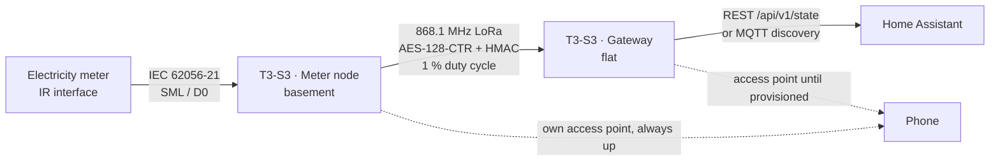

# lora-power-meter-bridge — electricity meter to Home Assistant over LoRa

Two LilyGO T3-S3 boards (ESP32-S3 + SX1262) replace the meter-reading part of a
smart-meter setup: one sits in the basement on the electricity meter's IR
interface, the other sits in the flat and hands the readings to Home Assistant.
They talk to each other over 868 MHz — no WLAN between them, no cloud, no
account.

One image runs on both boards. The role is picked once in the setup page and
stored in NVS, so the same `.bin` is flashed to either board and handed over
without a build step.



## What it does

| | Meter node (basement) | Gateway (flat) |
|---|---|---|
| UART | reads the meter through an IR read head on GPIO39/40 | unused |
| Radio | sends a telemetry packet every 15 s (never faster than the airtime limit allows at the chosen SF) | receives, ACKs, feeds Home Assistant |
| Network | keeps its own access point permanently — it is the on-site status display | joins the home WLAN, own AP only until provisioned, and again as fallback |
| Display | readings, protocol, polarity, link quality | received readings, link quality, IP |
| LED | solid = healthy, slow blink = no peer, fast blink = meter quiet | same |

The meter protocol is **detected, not assumed**: the firmware listens passively
for SML, flips the RX polarity if not a single byte arrives, and only then tries
an active IEC 62056-21 mode-C wake-up. Protocol and polarity can both be pinned
in the web UI for meters that detection gets wrong.

Readings are sealed with AES-128-CTR and an HMAC-SHA256 tag (6 bytes) under a key
derived from a 16-byte link secret and the network id. The secret is agreed
during pairing with an X25519 key exchange: each board sends only a fresh public
key, and both compute the same secret, which never goes over the air and is
never typed in. The pairing confirmation is sealed with the new key, so a board
only accepts the pairing once it knows the other side holds the same key. Both
boards then show the same four-digit *Kontrollzahl* (web page and display),
derived from the secret, so the owner can see that nobody sat in the middle of
the exchange. Only the pairing request and answer travel in the clear.

Time of day comes from the internet (NTP, time zone Europe/Berlin) on the board
that is in the home WLAN, normally the gateway. It passes the time to the other
board over the link: when the link comes up, after the other board restarts,
and every 6 hours (about 70 ms of airtime each). The receiver adds the frame's
airtime back, so both clocks agree to well under a second. The time stamps the
event log, shows on the display and under *System*. Ages and timeouts never
depend on it, and Home Assistant stamps readings with its own clock.

## Hardware

- 2 × **LilyGO T3-S3** (ESP32-S3, SX1262 868 MHz, 4 MB flash, OLED)
- 2 × 868 MHz antenna — attach **before** powering up
- 1 × TTL↔IR read head ("IEC 62056-21 Lesekopf")
- 2 × USB-C supply

Pin map, read-head wiring, the loopback test and mounting notes are in
**[docs/WIRING.md](docs/WIRING.md)**.

## Repository layout

```
firmware/
  lib/core/         hardware-free logic: SML parser + framer, packet codec,
                    duty-cycle accountant, airtime, AES/HMAC, ring buffer.
                    No Arduino headers — this is what the host tests exercise.
  src/              the device: app_config (NVS + identity), net (AP/STA,
                    captive portal, mDNS), radio_link, meter_reader,
                    web_server, display_ui, ha_mqtt, cli, main
  src/web_assets.h  the whole web UI as PROGMEM strings — nothing from a CDN,
                    because the setup page is served from an AP without internet
  test/             Unity suites for lib/core (native env)
  boards/ partitions/  custom 4 MB board JSON, dual-slot OTA layout
custom_components/  HACS-shaped Home Assistant integration (lilygo_power)
hacs.json           HACS metadata, at the repo root as HACS expects
tools/              flash/e2e/test harnesses, make_release.py (packages the
                    release images)
docs/               INSTALL.md, FLASHING.md, WIRING.md, flasher/ (browser
                    flasher page, deployed to GitHub Pages by CI)
flash.sh            build + flash + verify the running firmware stamp
VERSION             single source of version truth, stamped into the build
```

## Get the firmware onto the boards

No build needed: every release ships ready images.

1. **First install (USB):** open the
   [browser flasher](https://uniplayer1.github.io/lora-power-meter-bridge/) in Chrome/Edge
   and click *Connect & install*. Alternatively, flash
   `lilygo-power-<version>-factory.bin` from the
   [latest release](https://github.com/uniplayer1/lora-power-meter-bridge/releases/latest)
   with `esptool --chip esp32s3 --after watchdog-reset write-flash 0x0 <file>`.
2. **Set up** each board on its own WiFi page and choose its role:
   [docs/INSTALL.md](docs/INSTALL.md).
3. **Update later (WiFi):** board web page → *System* → *Firmware-Update* →
   `lilygo-power-<version>-update.bin`. Settings and pairing are kept.

Step by step, with troubleshooting: **[docs/FLASHING.md](docs/FLASHING.md)**.

CI (`.github/workflows/ci.yml`) runs the unit tests and builds the images on
every push and pull request. Pushing a tag `v<VERSION>` publishes a GitHub
Release with the images and deploys the browser flasher.

## Build, flash, verify

Requires [PlatformIO](https://platformio.org/) and Python 3.

```bash
./flash.sh            # build once, flash every board found, verify the version
./flash.sh 1 | 2      # flash one specific board (ordered by MAC)
./flash.sh build      # build only
./flash.sh monitor    # serial monitor over USB-CDC
./flash.sh version    # read the firmware stamp off a running board
./flash.sh native     # 30 host unit tests (SML, packet codec, duty cycle, crypto)
./flash.sh test       # on-device test suite over USB
./flash.sh erase      # full chip erase, then flash (wipes settings)
```

Every flash ends by reading the firmware stamp back off the board. The build
writes `FW_ID` (version + git sha + build time) into
`firmware/include/firmware_version.h`; the firmware prints it at boot and in a
heartbeat line every 5 s. A board that never reports its stamp is reported as a
warning, never as a success.

The image is written into **both** app slots and `otadata` is cleared, so a board
that took an OTA update before cannot keep booting the old slot. NVS is untouched
by that.

## First-time setup

Full walkthrough: **[docs/INSTALL.md](docs/INSTALL.md)**. In short: plug the board
in, join the WLAN the display shows, the captive portal opens by itself, pick the
role.

## Interfaces

### REST

`GET /api/v1/state` — **open, no authentication, on purpose**: Home Assistant
polls it and its sensors have no way to log in. Nothing that *changes* the device
is reachable without a session. Response shape:

```
device  name, role, fw, mac, uptime, heap, time, time_source, time_synced_s,
        can_configure
radio   freq_mhz, sf, cr, power_dbm, interval_ms (+ legal min/max)
wifi    mode, state, connected, ip, ap_ssid, ap_up, setup_code*, rssi, portal
link    radio, peer, paired, net, rssi, snr, age, encrypted, duty_pct, tx, rx,
        acks, missed, blocked, airtime_ms, budget_ms, pair_state, check_code
meter   protocol, polarity, valid, age, import_kwh, export_kwh, power_w,
        l1_w/l2_w/l3_w, telegrams, crc_errors, parse_errors, bytes, ...
peer_status  (gateway; null until the meter node has reported) age, duty_pct,
        airtime_s, blocked, uptime, heap, heap_min, rssi, snr, telegrams,
        telegram_errors, telegram_age, meter_protocol, meter_resolved,
        inverted, simulating, rx_pin, bytes
```

`link`, `device` and the budget figures are always the board that answers. The
meter node reports its own airtime, memory, reception and read-head counters to
the gateway every 5 minutes (and shortly after the link comes up); that report
is `peer_status`.

`*` filled only for clients on the device's own access point.

Other endpoints: `/api/state` (same document, used by the page), `/api/scan`,
`/api/dump` (raw last telegram), `/api/setup`, `/api/save`, `/api/action`,
`/api/mqtt` (discovery dump), `/ha/power_meter.yaml` and `/ha/card.yaml`
(generated for this device's IP and entity ids), `POST /ota` (firmware upload).

### MQTT

Optional, off until a broker is entered. It is the zero-file path: REST has no
discovery, so it always needs a package file copied in. Discovery configs go to
`<prefix>/<component>/lilygo_power_<id>/<object>/config` (retained), state to
`<base>/state`, availability to `<base>/status`. 26 entities on two devices:
*Stromzähler Keller* has the readings (energy in/out, power total and per
phase, measurement validity) and the meter node's own diagnostics from its
report (airtime budget, held-back sends, reception, memory, uptime, read-head
bytes, report age); the gateway device has its own airtime budget, reception,
link age, uptime, memory and the radio-link state. The unique ids of the
entities that existed before the split did not change.

### Home Assistant

Both paths ship and work:

1. **REST package** — download `power_meter.yaml` on the gateway page, drop it
   into `packages/`. Nothing to install, but a file to copy by hand.
2. **Custom integration** — `custom_components/lilygo_power`, HACS shaped,
   config-flow, discovers the device via `_lilygopower._tcp.local.` mDNS.
   See its own [README](custom_components/lilygo_power/README.md).

`tools/ha_payload_test.py` checks the integration's entity table against a live
device's JSON without running Home Assistant.

### Serial shell

`./flash.sh monitor`, then `help`. Notable: `status`, `config`, `duty`,
`meter dump|sim|loopback|protocol|polarity|pins|scope`, `mqtt ...`,
`link secret [hex]`, `selftest`, `log`, `reboot|factory`. The same shell is what
`tools/e2e.py` drives.

## Regulatory constraints (not tuning knobs)

868.0–868.6 MHz (ERC/REC 70-03 Annex 1 h1.5, BNetzA Vfg. 91/2025) allows
**25 mW ERP (14 dBm)** and **1 % duty cycle over a rolling hour — 36 s**.

- output power is clamped to 14 dBm in `RadioLink::begin()`; a larger config
  value is refused, never honoured
- every transmission passes `core::DutyCycleBudget`; when the budget is spent the
  scheduler stretches its interval instead of transmitting illegally
- airtime is computed with the Semtech formula (`core::loraAirtimeMs()`) and unit
  tested — not taken from a library call whose return unit nobody verified

## Verification

| Command | What it proves |
|---|---|
| `./flash.sh native` | 30 host tests: SML grammar (incl. a byte-exact EasyMeter Q3 telegram), packet codec round-trip, duty-cycle accounting, airtime, AES/HMAC |
| `python3 tools/e2e.py` | 11 on-device checks over USB: shell answers, version, identity from the MAC, legal power limit, 36 s budget, self test, simulator producing parsed values |
| `./flash.sh monitor` + `meter loopback on` | the real UART path with TX jumpered to RX (GPIO40→GPIO39 by default): synthesised SML out of TX, back in on RX, parsed |
| `python3 tools/ir_head_test.py` | the IR read head alone, through a USB-TTL adapter |
| `python3 tools/ha_payload_test.py` | the HA entity table against a device's live JSON |
| `python3 tools/ttl_loopback_test.py` | the UART wiring without the firmware |

## Further reading

- **[AGENTS.md](AGENTS.md)** — the decisions that shape this codebase, and the
  gotchas that already cost time once
- **[docs/FLASHING.md](docs/FLASHING.md)** — first install, updates, publishing a release
- **[docs/INSTALL.md](docs/INSTALL.md)** — setup for the person installing the boards
- **[docs/WIRING.md](docs/WIRING.md)** — IR head, pin map, loopback, antennas

## License

[Apache License 2.0](LICENSE).
